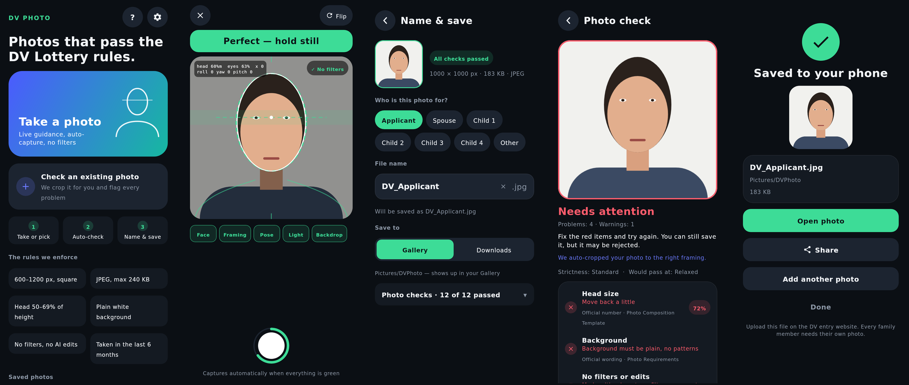
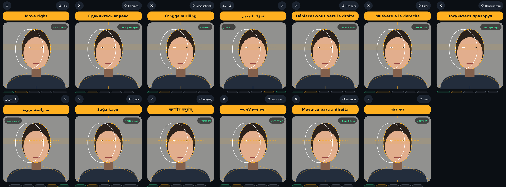

# DV Photo Camera

Android app (Kotlin, Jetpack Compose, CameraX, ML Kit) that helps you take or check a photo for the
**U.S. Diversity Visa (DV) Lottery** — and refuses to call it "ready" unless it meets the rules.

Everything runs on the phone. No account, no upload, no backend. Not affiliated with the U.S. government.



*Rendered headlessly from the app's real Compose code with a synthetic portrait (see `harness/`). The same screen in
all thirteen languages: *

## What it does

| | |
|---|---|
| **Guided camera** | Square viewfinder with on-screen shapes: target head oval, shoulder guide, allowed eye-line band, centre ticks. Your detected head is drawn in white — line it up with the coloured target. |
| **One instruction at a time** | "Move closer", "Look straight at the camera", "Shadow on your face"… plus five status chips. Optional spoken guidance. |
| **Auto-capture** | Fires after everything has been green and steady for 1.2 s at the default level (0.8 s relaxed, 1.6 s strict), or tap the button. Exposure and focus are metered on your face, so a bright white wall doesn't darken it. |
| **Strictness levels** | *Relaxed* (exactly the official numbers), *Standard* (a small safety margin, the default) and *Strict* (a wide margin, tight checks; edited or undated photos fail) — *Settings → Strictness*. A photo that fails also says at which looser levels it would pass. Official limits are never loosened. |
| **Rule sources** | Every check is tagged *official number* or *official wording* with the State Department page it comes from (*Help → Where the rules come from*, and under each problem). Rules carry the month they were last compared with the official pages and the app warns when they get old. See [docs/RULES.md](docs/RULES.md). |
| **No filters — enforced** | See [below](#no-filters-no-ai). |
| **Check an existing photo** | Pick any picture: it is auto-cropped around the face, every rule is reported, and the file's metadata is searched for AI / filter / editing marks and its age. |
| **Name & save, directly** | A photo that passes goes straight to a *Name & save* screen: pick who it is for (applicant, spouse, child 1–4), rename the file, choose Gallery or Downloads, save. Duplicate names get " (1)". Or "Choose another location…" with the system file picker. |
| **Family friendly** | The name field suggests the first role you haven't saved yet (`DV_Applicant.jpg`, `DV_Spouse.jpg`, `DV_Child1.jpg`…). |
| **13 languages** | English, Русский, Oʻzbekcha, then the languages of the countries that enter the lottery most: العربية (RTL), Français, Español, Українська, فارسی (RTL), Türkçe, नेपाली, አማርኛ, Português, বাংলা — switch in Settings. |
| **Works on old and new phones** | Android 7.0 (API 24) → 15. Tablets/foldables get a centred, width-capped layout. No camera? You can still check photos. Phones that cannot run three camera streams at once fall back to manual shutter. |

### No filters, no AI

The State Department wants an unedited photo. This app never edits pixels — it only **crops and resizes**.

* **Camera**: CameraX is used *without* Extensions (the OEM HDR / Night / Bokeh / Face-Retouch / "Auto" modes). Every
  use case also pins Camera2 `CONTROL_EFFECT_MODE = OFF` and `CONTROL_SCENE_MODE = DISABLED` under plain `AUTO`
  control, flash is off, and the output is a standard SDR JPEG (never Ultra HDR). The result is re-drawn into a fresh
  sRGB bitmap, so colour profiles, HDR gain maps and all metadata are dropped.
* **Uploads** are scanned (metadata only, never pixel data) for: IPTC `DigitalSourceType` AI values, C2PA Content
  Credentials that record filter / edit actions, names of AI tools and beauty / filter apps in the software tags
  (BeautyPlus, Meitu, FaceApp, Facetune, Instagram, Midjourney, Firefly, "Galaxy AI", "Magic Editor", …), portrait/depth
  mode, general editors (Photoshop, Lightroom, Snapseed… → warning) and the **date taken** (must be within 6 months).
* What cannot be detected from a file: retouching done and saved by an app that writes no marks. The app says so.

## Rules enforced

Official numbers live in `core/…/DvRules.kt`, the per-level limits in `core/…/Strictness.kt`, and where each rule
comes from in `core/…/RuleCatalogue.kt` (explained in [docs/RULES.md](docs/RULES.md)). Values below are for the
default *Standard* level.

| Rule | Kind | Value |
|---|---|---|
| Image | official number | square, saved at exactly 600 × 600 px (the allowed range is 600–1200), JPEG, ≤ 240 KB (quality is reduced to fit) |
| Head height | official number | 50–69 % of image height (we insist on 52–67 %), measured to the top of the hair |
| Eye line | official number | 56–69 % from the bottom (we insist on 58–67 %) |
| Photo age | official number | taken within 6 months |
| Pose | official wording | roll ≤ 5°, yaw ≤ 8°, pitch ≤ 10°, eyes open, neutral expression (smile = warning) — the angles are the app's own |
| Light | official wording | face neither too dark nor too bright; no half-face shadow |
| Background | official wording | light (≥ 170/255), plain: lighting gradients are fine, patterns / shadows / edges / posters are not; neutral colour |
| Sharpness | official wording | Laplacian-variance on the face |
| Editing | official wording | no AI / beauty-app marks (always a failure); editing software or portrait mode (warning; a failure at *Strict*) |

**Always verify these numbers against the current State Department instructions before each registration
period** — `docs/RULES.md` has the checklist and what was found when this version was verified. Head-top is measured
on the pixels (walking up from the forehead until the plain wall starts); when that is impossible (white hair on a
white wall) it falls back to an estimate from the face contour — *Settings → Show measurements* shows the live
numbers (`m` = measured, `e` = estimated) so you can calibrate on a few real faces.

Not detectable: glasses, hats / head coverings. The app asks up front and lists them in Help.

First time on a real phone? See [docs/DEVICE_TESTING.md](docs/DEVICE_TESTING.md) for the calibration steps and the test checklist.

## Architecture

```
core/      pure Kotlin, no Android: official rules, strictness levels, rule catalogue (sources), validator,
           scene maths, head-top finder, smart crop, EXIF/XMP/C2PA metadata scanner, provenance checks,
           file naming                                                            (JVM unit tests)
app/       Android app
  ui/        pure Compose screens + state holders (no Android imports)      (rendered headlessly by harness/)
  host/      the Android-only Compose glue: pickers, permissions, camera preview, intents
  platform/  CameraX session, ML Kit, imaging/export, MediaStore storage, prefs, locale, TTS
  data/      Room database of saved photos
harness/   headless Compose Desktop project: compiles core + ui, renders every screen in every language to PNG
tools/     check-android.sh (compile Android code against stubs), check_resources.py (+ its tests),
           make_screenshots.py (README images from the harness renders),
           check_rules_online.py (monthly CI watch: do the official pages still show our figures?)
```

Memory: live analysis reads only the camera's Y plane at ~6 fps (no per-frame bitmaps); uploads are decoded down to
2000 px; one JPEG (≤ 240 KB) is kept per result.

## Build & test

```
./gradlew :core:test :app:assembleDebug        # needs the Android SDK (CI job "android")

# no Android SDK needed:
python3 tools/check_resources.py               # keys, placeholders, locales
python3 tools/test_check_resources.py          # tests of the checker
./gradlew -p core test                         # rules engine (JVM)
./gradlew -p harness desktopTest               # compile + render screens → harness/build/screenshots/*.png
tools/check-android.sh                         # compile host/platform/ViewModel against the real android.jar + stubs
```

What each layer proves — and what it does not:

* `core` tests exercise every rule, the metadata parser (with synthetic JPEGs), file naming, the head-top finder
  on rendered synthetic portraits, background analysis (gradients vs. shadows, posters, grain), the strictness levels
  (a stricter level never passes what a looser one fails; official limits never loosen) and the rule catalogue.
* `harness` compiles the real UI sources and renders them (Compose Multiplatform 1.5 / Skia) in 13 languages,
  including RTL, so overflow and clipping are caught.
* `check-android.sh` type-checks the Android code against the real `android.jar` and hand-written stubs of CameraX,
  ML Kit, Room, lifecycle and activity-compose. A stub is only as accurate as its author — **the Android build and a
  device remain the judges**. Nothing here has been run on a phone yet.

## Privacy

* Photos are processed on the device and written only where you choose. The app contains no networking code,
  no account, no analytics and no ads.
* The app's own manifest requests only `CAMERA` and, on Android 9 and older, `WRITE_EXTERNAL_STORAGE`
  (to save into Pictures/Download).
* Third-party libraries (notably Google's ML Kit) can merge extra permissions such as `INTERNET` into the final
  manifest for their own anonymous usage statistics. This has **not** been checked here (no Android build was possible);
  inspect *Merged Manifest* in Android Studio, and if you want a hard guarantee, test removing it with
  `tools:node="remove"` on a real device before shipping — ML Kit's bundled face model itself works offline.
